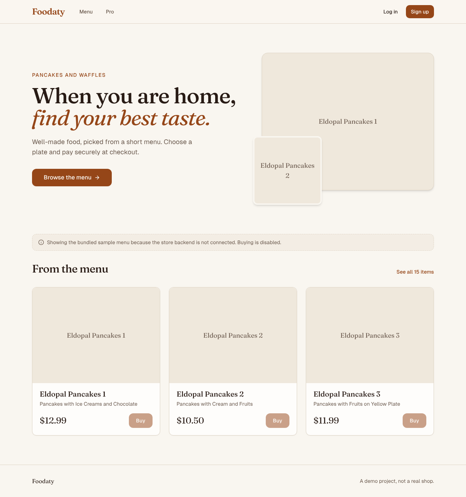
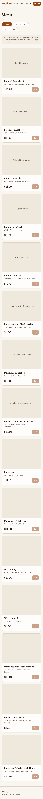

# Foodaty

A small online shop built with Next.js (App Router), Convex, Clerk, Stripe, Upstash and React Email. The catalog is a short pancake and waffle menu. Items can be bought one by one, and there is a monthly or yearly "Pro" subscription page.

Live demo: https://next-e-commerce-virid-chi.vercel.app (the deployed backend accounts are the owner's, this repo does not include them).




## Credits and origin

This project follows the structure of a public tutorial for a Convex + Clerk + Stripe course-selling platform, and I am not claiming the overall design as original. Signs of that: the `courses` / `purchases` / `subscriptions` tables, the monthly/yearly `PRO_PLANS`, the "MasterClass" branded email templates and the `/courses` routes. I could not identify the exact tutorial, and the git history available here has a single commit, so I cannot show how much was changed.

What was changed afterwards (with AI assistance, see Notes): the catalog data is food items (`courseData.json`) rather than courses, and the UI, bug fixes and docs on this branch were added later. Some copy is still inherited from the course platform (the Pro page features, the email templates, the `/courses` route names) and does not match a food shop. That is a known limitation, not a design choice.

## Stack

Next.js 15, React, Tailwind CSS, shadcn/ui style components, Convex (database and functions), Clerk (auth), Stripe (checkout, billing portal, webhooks), Upstash Redis (checkout rate limit), Resend and React Email (email templates).

## Run it

You need accounts for Convex, Clerk, Stripe, Upstash and Resend. I could not create these, so the full purchase flow was not run.

```bash
npm install
cp .env.example .env.local   # fill in values
npx convex dev               # creates the deployment, set the Convex env vars from .env.example
npm run dev
```

Seed the catalog by importing `courseData.json` into the `courses` table (for example with `npx convex import --table courses courseData.json`, or through the Convex dashboard). Not run here.

Point a Clerk webhook (`user.created`) at `<convex-site-url>/clerk-webhook` and a Stripe webhook at `/api/webhooks/stripe`.

### Environment variables (names only)

Next.js app (`.env.local`): `NEXT_PUBLIC_CONVEX_URL`, `NEXT_PUBLIC_CLERK_PUBLISHABLE_KEY`, `CLERK_SECRET_KEY`, `NEXT_PUBLIC_APP_URL`, `STRIPE_SECRET_KEY`, `STRIPE_WEBHOOK_SECRET`, `RESEND_API_KEY`.

Convex dashboard environment: `CLERK_JWT_ISSUER_DOMAIN`, `CLERK_WEBHOOK_SECRET`, `STRIPE_SECRET_KEY`, `NEXT_PUBLIC_APP_URL`, `STRIPE_PRICE_ID_MONTHLY`, `STRIPE_PRICE_ID_YEARLY`, `UPSTASH_REDIS_REST_URL`, `UPSTASH_REDIS_REST_TOKEN`.

`.env.example` has placeholders for all of them. The Clerk publishable key placeholder is a correctly formatted dummy so the app builds without an account.

## Demo data

`courseData.json` holds 15 pancake and waffle items with prices and Pexels image URLs. It is demo data. If Convex is not configured or unreachable, the landing page and menu show this bundled list with a notice and the Buy buttons disabled.

## How this was verified

- `npm run lint` and `npm run build` pass with only the placeholder env values from `.env.example`.
- Landing, menu (including sorting), Pro and 404 pages were rendered in Chromium at 1280x800 and 390x844 with no horizontal overflow. For those screenshots I used a local copy with Clerk and the auth middleware stubbed, because Clerk needs a real account. The stubs are not in this repo. The Pexels images are blocked in my environment, so screenshots show the image fallback tiles instead of photos.
- Not run: sign-in, checkout, Stripe webhooks, billing portal, Convex queries, emails.

## Known limitations

- Purchase and Pro flows are untested against real services. `createProPlanCheckoutSession` was missing from the original code and was added on this branch, unverified.
- Purchase confirmation emails are only sent when `NODE_ENV` is `development` and the checkout metadata contains a title and image, which checkout does not set, so they are effectively off.
- Pro page copy, email templates and `/courses` route names still come from the course-platform origin.
- No automated tests. CI runs lint and build only.
- No dark mode toggle (the original had CSS variables for it but never wired it up).
- Some item titles in `courseData.json` contain typos ("delecious") and are shown as given.

## Scripts

`npm run dev`, `npm run build`, `npm run start`, `npm run lint`, `npm run email:dev`.

## Notes

UI and code quality improvements were made with AI assistance (Claude, Anthropic), reviewed and verified by building and running the app.
